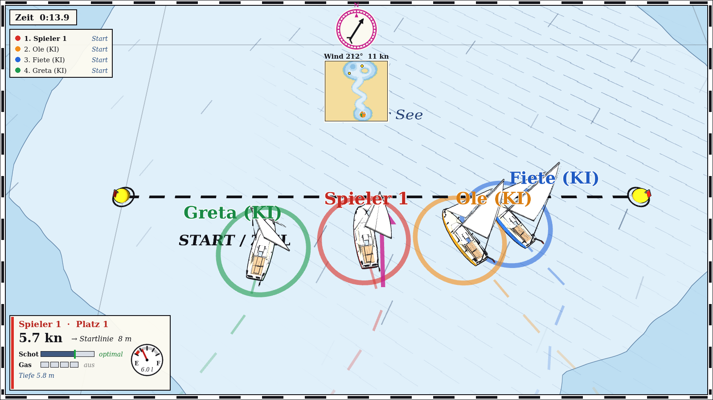
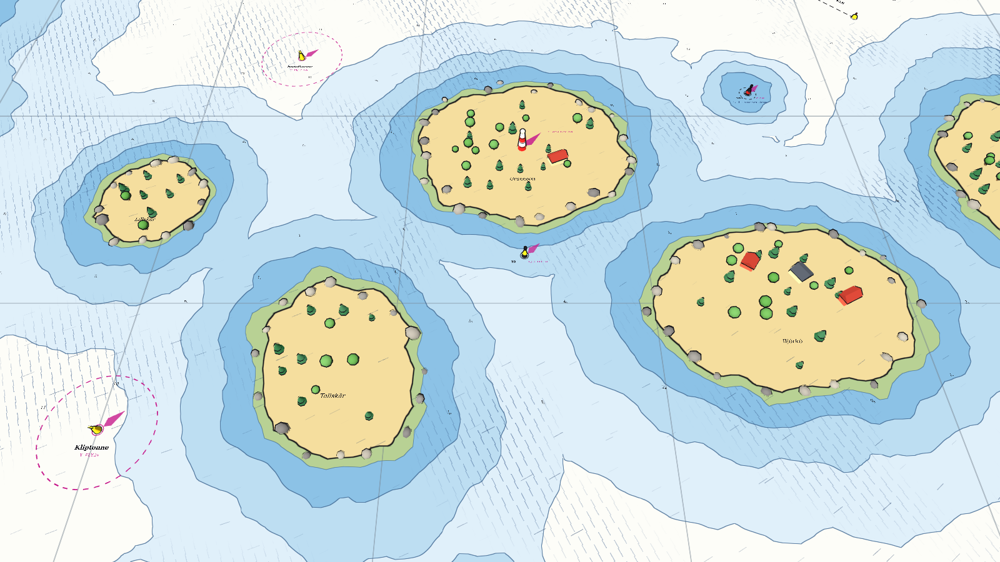
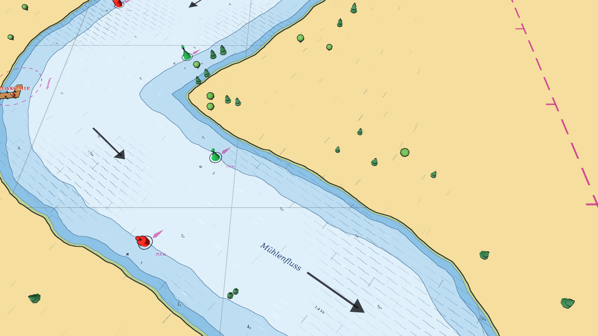
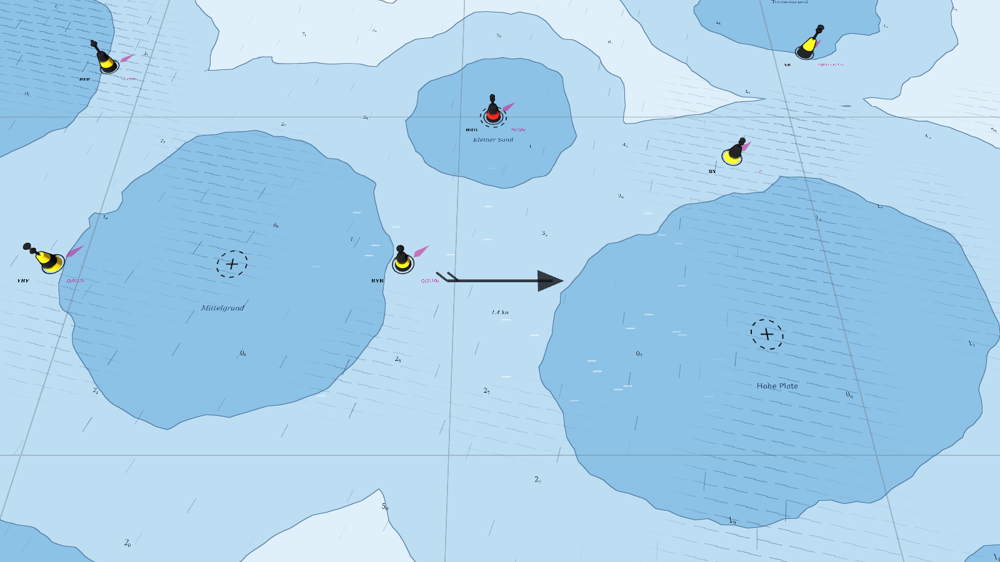

# ⛵ Regatta

**Ein Segel-Rennspiel auf der Seekarte – für bis zu vier Skipper an einem Bildschirm, im LAN oder übers Internet.**

Zieh die Schot dicht, lies den Wind und kreuz dich zwischen Sandbänken, Schären und
Kardinaltonnen zur Luvtonne hoch. Wer zuerst alle Tonnen gerundet hat und durchs Ziel geht,
gewinnt. Aber Vorsicht: Böen, Winddreher, Windschatten und Strömungen machen jede Bahn
anders. Und wer zu weit ins Flache gerät, sitzt fest, bis der Schlepper kommt.

- **Echtes Segelgefühl, einfach zu steuern:** nur Pinne und eine Schot. Wenden und Halsen
  segelt man durch Lenken.
- **Seekarten-Look** nach Karte 1 / INT 1: Tiefenlinien, Lotungen, Seezeichen nach IALA A,
  Leuchttürme und Molenfeuer.
- **7 Bahnen** vom kurzen Up-and-Down über die Lotsenrinne und den Schärengarten bis zur
  Flussregatta im Binnenrevier.
- **Außenborder und Tankstellen:** Motor anwerfen, wenn der Wind nicht will, aber der Sprit
  reicht nie für die ganze Strecke.
- **Computergegner** in drei Stärken: Fülle freie Plätze auf oder schau vier KI-Booten zu.
- **Geteilter Bildschirm**, der sich automatisch teilt, wenn die Boote auseinanderfahren.
- **Mehrspieler** im LAN oder übers Internet mit Lobby, bis zu 4 Boote.
- **Level-Editor** direkt in Godot: Tonnen setzen, Flüsse ziehen, Seegrund malen.

| | |
|---|---|
|  |  |
|  |  |

---

## Installation

**Fertige Version:** Unter [Releases](../../releases) die Datei für dein System laden,
entpacken, starten. Windows warnt beim ersten Start, weil das Spiel nicht signiert ist
(„Weitere Informationen → Trotzdem ausführen“). Auf dem Mac per Rechtsklick → Öffnen.

**Aus dem Quellcode:** [Godot 4.3](https://godotengine.org/download) oder neuer
installieren, Godot starten → *Importieren* → `project.godot` wählen → **F5**.

---

## Anleitung

### Schnellstart

1. Im Menü eine **Bahn** wählen.
2. **Besetzung** einstellen: 2 Spieler, 1 Spieler gegen 1 oder 3 Computer, 2 gegen 2 oder
   Zuschauen.
3. Optional Computer-Stärke, Windstärke, Böen und Treibstoff anpassen.
4. **Leinen los!** Nach dem Countdown geht's über die Startlinie.

### Steuerung

| | Controller | Tastatur Spieler 1 | Tastatur Spieler 2 |
|---|---|---|---|
| Lenken (Pinne) | linker Stick | A / D | J / L |
| Schot dicht / fieren | RT / LT (oder rechter Stick) | W / S | I / K |
| Gas hoch (Motor springt an) | A / Steuerkreuz ↑ | E | O |
| Gas runter (auf 0 = Motor aus) | B / Steuerkreuz ↓ | Q | U |
| Nächstes Rennen (nach dem Ziel) | Start | Leertaste | Enter |

`F5` startet das Rennen neu, `Esc` führt zurück ins Menü, `M` schaltet die Musik an und aus.
Ein Controller kann auch ein Switch-Pro-Controller oder Joy-Con sein, der per Bluetooth
mit dem PC verbunden ist.

### Die Bahn

- Die **Startlinie** liegt zwischen zwei Tonnen. Über die Linie in Pfeilrichtung startet das
  Rennen.
- Die **gelben Bahnmarken** werden in der angezeigten Reihenfolge gerundet. Die nächste
  Marke und ihre Entfernung stehen in deinem Spielerfeld.
- Am Schluss geht es zurück durch dieselbe Linie, jetzt in Gegenrichtung. Das ist das Ziel.
- Die **magenta Linie mit „T“-Zeichen** begrenzt das Regattagebiet. Wer hinausfährt, wird
  abgebremst und gestoppt.

### Segeln in einer Minute

- **Wind:** Die Windrose oben zeigt, woher der Wind kommt. Graue Striche auf dem Wasser
  zeigen seine Richtung, Riffel-Schraffur zeigt eine **Böe**.
- **Gegen den Wind** (etwa 40° links und rechts davon) kommt man nicht voran. Dort hilft nur
  **kreuzen**: im Zickzack hoch und durch Lenken **wenden**. Dreh zügig durch den Wind, sonst
  bleibst du stehen („Im Wind – abfallen!“).
- **Schot:** Der grüne Strich im Schot-Balken zeigt die beste Stellung. Ist die Schot zu
  offen, killt das Segel. Ist sie zu dicht, krängt das Boot und wird langsam. Am Wind dicht
  holen, vor dem Wind weit fieren.
- **Windschatten:** Wer in Lee hinter einem anderen Boot fährt, bekommt weniger Wind. Das
  kann man nutzen und sollte es selbst vermeiden.
- **Am schnellsten** ist das Boot mit halbem Wind (seitlich).

### Seekarte lesen

- **Tiefen:** Je dunkler das Blau, desto flacher. Die kleinen Zahlen sind Wassertiefen in
  Metern. Die Dehler hat 1 m Tiefgang.
- **Grundberührung** bremst stark. Wer richtig festsitzt, bekommt nach ein paar Sekunden den
  **Schlepper** geschickt. Der kommt gemächlich und zieht dich ins Tiefe.
- **Kardinaltonnen** (gelb-schwarz) zeigen, auf welcher Seite das tiefe Wasser liegt. An der
  Nordtonne fährt man nördlich vorbei, an der Südtonne südlich und so weiter.
  Schwarz-rot-schwarz markiert eine **Einzelgefahr**, rote und grüne Tonnen begrenzen ein
  **Fahrwasser**. An allen Tonnen prallt man ab.
- **Strömungen:** Pfeile mit „x kn“ und wandernde Schlieren auf dem Wasser. Sie versetzen
  das Boot. Mit dem Strom ist man schneller, dagegen langsamer. Manche Gezeitenströme
  kentern während des Rennens.

### Motor und Tanken

- **Gas hoch** wirft den Außenborder an (kurz der Anlasser). **Gas ganz runter** stellt ihn
  ab. Es gibt 4 Stufen, Vollgas sind etwa 6 kn.
- Die **Tankuhr** in deinem Spielerfeld zeigt den Sprit, rot heißt Reserve. Vollgas
  verbraucht viel, Halbgas nur gut ein Drittel davon.
- Wie viel im Tank ist, stellst du im Menü unter **Treibstoff** ein. Normalerweise reicht
  es **nicht** für die ganze Bahn.
- **Tankstellen** erkennst du am Steg mit roter Zapfsäule und dem magenta gestrichelten
  Liegeplatz. Dort anhalten und den Motor aus (Gas auf 0), dann wird getankt. Das dauert ein
  paar Sekunden, in denen die Segler weiterfahren. Gut überlegen, ob es sich lohnt!

### Computergegner

| Stärke | Verhalten |
|---|---|
| Leicht | reagiert langsam, trimmt ungenau, Motor nur, wenn es im Wind hängen bleibt |
| Mittel | solider Segler mit kleinen Fehlern, Motor eher selten |
| Schwer | trimmt fast perfekt, nutzt Winddreher und Böen, setzt den Motor taktisch ein |

### Die Bahnen

| | Bahn | Besonderheit |
|---|---|---|
| 1 | Mittelgrund-Regatta | Dreieckskurs zwischen Untiefen mit Kardinaltonnen, Leuchtturm, Plattenstrom |
| 2 | Kurzer Up-and-Down | zum Einsegeln, leichter Wind, keine Tankstelle |
| 3 | Rund um Möwenhörn | einmal um die Leuchtturminsel, Seehundsstrom |
| 4 | Hafenausfahrt | Start im Hafen zwischen Felsmolen, Strom in der Einfahrt |
| 5 | Lotsenrinne | Kreuzen im betonnten Fahrwasser zwischen zwei Sandbänken, Ebbstrom |
| 6 | Schärengarten | bewaldete Schären, Klippen, zwei Sunde mit Strömung, böiger Wind |
| 7 | Flussregatta | Binnenrevier: den Mühlenfluss gegen den Strom hinauf in den Großen See und zurück |

---

## Mehrspieler (LAN / Internet)

Bis zu **4 Boote**, an jedem Rechner 1 oder 2 Skipper. Alle brauchen **dieselbe
Spielversion**.

1. Im Menü auf **„Mehrspieler (LAN / Internet)“**, Namen eintragen und wählen, wie viele
   Skipper an diesem Rechner segeln.
2. Einer klickt **„Spiel eröffnen“** und ist damit Host.
3. Die anderen treten bei:
   - **Im selben Netzwerk** erscheint das Spiel unter „Offene Spiele im Netzwerk“. Einfach
     anklicken.
   - **Übers Internet** ist ein virtuelles Netzwerk am einfachsten, zum Beispiel
     [ZeroTier](https://www.zerotier.com) oder [Tailscale](https://tailscale.com). Alle
     treten demselben Netz bei, dann klappt es wie im LAN. Bei Tailscale trägt man die
     100.x.x.x-Adresse des Hosts unter „Direkt verbinden“ ein.
   - Alternativ gibt der Host im Router **UDP-Port 24850** frei und schickt seine
     öffentliche IP. Das geht nicht bei Anschlüssen ohne eigene IPv4-Adresse (DS-Lite).
4. Der Host wählt Bahn, Wetter, Treibstoff und Computergegner und klickt
   **„Rennen starten“**.

Nach dem Zieleinlauf startet der Host das nächste Rennen. Mit `Esc` geht es zurück in die
Lobby.

---

## Eigene Bahnen bauen

Jede Bahn ist eine normale Godot-Szene in `levels/`, und alles dort erscheint automatisch
im Menü. Mit dem mitgelieferten Editor-Plugin setzt du Tonnen, Inseln, Strömungen, Flüsse
und Tankstellen per Klick und malst den Seegrund mit dem Pinsel.
Anleitung und Code-Überblick: **[docs/ENTWICKLUNG.md](docs/ENTWICKLUNG.md)**

## Credits

- Spiel, Code, 3D-Modelle (Dehler 31 „Schruvtrekker“, Schlepper), Soundeffekte und Musik
  entstanden zusammen mit Claude (Anthropic).
- Gebaut mit der [Godot Engine](https://godotengine.org) (MIT-Lizenz).
