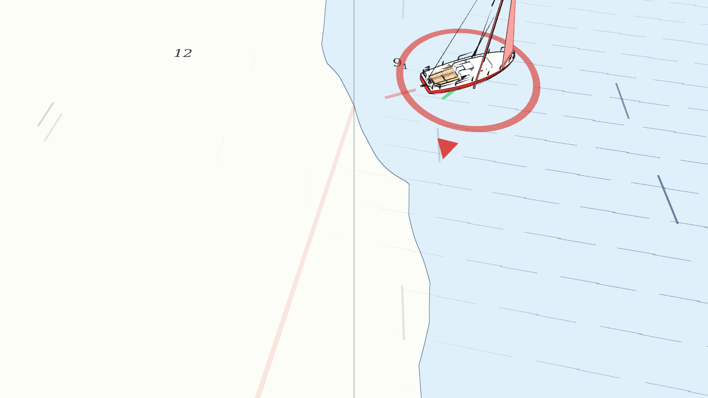
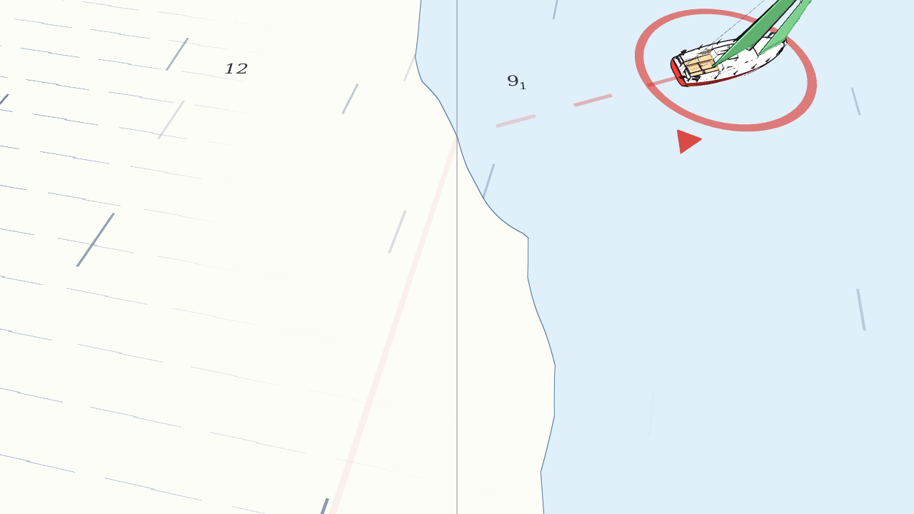

# Das Boot (`boat.gd`)

Datei: `scripts/boat.gd`, `class_name Boat`, `extends Node3D`, etwa 950 Zeilen. Es ist das
größte Skript und das Herz des Spiels. Es enthält:

* die **Segelphysik** (Wind, Schot, Polarkurve, Krängung),
* **Grund, Land, Strömung, Gebietsgrenze**,
* **Motor und Tank**,
* **Wendeschub, Kollisionsfolgen, Haltezustände, Explosion**,
* **Netzwerk-Zustand** (`net_pack`/`net_unpack`) und die Puppet-Variante für Clients,
* die **Optik** (Modell, Segelstellung, Krängung, Klang, Segel-Overlay).

!!! tip "Lesetipp"
    Lies erst die Abschnitte [Segelphysik](#segelphysik-schritt-fur-schritt) und
    [Der Physikschritt](#der-physikschritt-in-reihenfolge). Die Optik ist reines Beiwerk.

## Koordinaten und Konventionen

* Die Physik läuft in der **Wasserebene (x, z)**. `vel` ist ein `Vector2` in m/s.
* `heading` (Radiant): `0` = Bug nach +z (Süden). Vorwärtsvektor
  `fwd = Vector2(sin(heading), cos(heading))`.
* **Backbord** (links) ist `port = Vector2(cos(heading), -sin(heading))`.
* Lokal im Node: +z vorn, +x Backbord (links), −x Steuerbord.

```
              Bug (+z lokal)
                ▲
   Backbord     │     Steuerbord
   (+x, links)  │     (-x, rechts)
        ◄───────┼───────►
                │
              Heck (-z lokal)
```

## Wichtige Variablen

| Gruppe | Variablen | Bedeutung |
|---|---|---|
| Lage | `heading`, `vel`, `position` | Kurs, Geschwindigkeit durchs Wasser, Ort |
| Segel | `sheet` (0 dicht … 1 offen), `jib_sheet`, `heel` | Schotstellung, Krängung (rad) |
| Motor | `throttle` 0–4, `engine` (`AUS`/`ANLASSER`/`LAEUFT`), `fuel`, `has_engine`, `refueling` | |
| Umwelt | `current`, `depth` | Strom am Boot, Wassertiefe |
| Zustände | `aground`, `stuck`, `stuck_time`, `towed`, `tug` | Grundberührung, festgefahren, abgeschleppt |
| Gefahren | `out`, `hold_kind`, `hold_time`, `immune_time`, `penalty`, `boost` | siehe unten |
| Bahn | `next_target`, `finished`, `finish_time` | Fortschritt |
| Anzeige | `awa`, `aws`, `tws`, `boom_abs`, `boom_opt`, `luffing`, `in_irons`, `in_shadow`, `message` | für HUD und Overlay |
| Eingabe | `input: PlayerInput` | **das Eingabegerät**: Mensch, KI oder Netzwerk |
| Netzwerk | `puppet`, `_net_pos`, `_net_heading` | Client-Boot, das nur anzeigt |

!!! note "`input` ist austauschbar"
    `Boat` liest nur `input.steer`, `input.sheet_rate`, `input.gas_up_pressed`,
    `input.gas_down_pressed`. Ob dahinter ein Mensch mit Controller, der Computer oder ein
    Spieler am anderen Rechner sitzt, weiß das Boot nicht. →
    [Eingabe](eingabe.md), [Computergegner](ki.md), [Netzwerk](netzwerk.md#net-input-gd).

## Der Physikschritt in Reihenfolge

`_physics_process(delta)` läuft 60× pro Sekunde und macht diese Schritte:

```
 0. wind == null?          → nichts tun            puppet?  → _puppet_step() (nur anzeigen)
 1. input.update()         → Eingabe einlesen
 2. out?                   → Boot ist explodiert: stehen bleiben, fertig
 3. Timer                  → boost, Wendesperre, penalty, immune_time ablaufen lassen
 4. towed?                 → vom Schlepper gezogen: nur Segel anzeigen, fertig
 5. hold_kind != 0?        → Polizei/Sirenen halten fest (Zeit zählt runter)
 6. Wind holen             → wahrer Wind, Böe, Windschatten, Strömung
 7. Eingabe anwenden       → Pinne, Schot, Gas (gesperrt, wenn festgehalten)
 8. Drehen                 → heading ändern
 9. scheinbarer Wind       → awa, aws
10. Segel trimmen          → boom_abs, jib_abs, trim_eff, luffing
11. Krängung               → heel, heel_pen
12. Kräfte                 → Vortrieb, Wasserwiderstand, Schwert → spd_fwd, spd_lat
13. Grund                  → Bremsen im Flachen, festgefahren
14. Bewegen                → Position, Strömung, Gebietsgrenze, Land
15. Bahnfortschritt        → course.update_progress(...)
```

## Segelphysik Schritt für Schritt { #segelphysik-schritt-fur-schritt }

Jeder Schritt ist eine kurze Formel. Alle zusammen ergeben ein Boot, das sich **glaubwürdig
segelt**, ohne Strömungsmechanik.

### Schritt 1: Der scheinbare Wind

Ein Segel spürt nicht den „wahren“ Wind, sondern den Wind relativ zum bewegten Boot:

```gdscript
var app := tw - (vel + current)        # wahrer Wind minus Fahrt über Grund
aws = app.length()                     # scheinbare Windgeschwindigkeit (m/s)
var from := -app                       # Richtung, AUS der er scheinbar kommt
awa = atan2(from.dot(port), from.dot(fwd))   # Winkel zur Bootsachse, + = von Backbord
var abs_awa := absf(awa)
```

* `tw` ist der Wind in Blasrichtung. Fährt das Boot mit dem Wind, wird `app` kleiner (weniger
  Druck), fährt es gegen den Wind, größer.
* `awa` kommt aus den zwei Skalarprodukten: `from.dot(fwd)` ist der Anteil **von vorn**,
  `from.dot(port)` der Anteil **von links**. `atan2` macht daraus den Winkel.

**Rechenbeispiel.** Wind 6 m/s aus Norden, Boot steht (`vel = 0`) mit Kurs Ost
(`heading = π/2`):

| Größe | Wert |
|---|---|
| `tw` | `(0, +6)` (Wind weht nach Süden) |
| `fwd` | `(1, 0)`, `port` = `(0, −1)` |
| `from` | `(0, −6)` |
| `awa` | `atan2(6, 0)` = 90° (Wind genau von Backbord, halber Wind) |

### Schritt 2: Die Schot begrenzt den Baum

```gdscript
var boom_max := lerpf(0.06, 1.5, sheet)          # so weit lässt die Schot den Baum aufgehen
var limit := maxf(abs_awa - 0.08, 0.0)           # so weit würde ihn der Wind drücken
boom_opt = clampf(abs_awa * 0.5 - 0.1, 0.06, 1.45)   # ideale Baumstellung
luffing = boom_max >= limit                      # Schot ist lose genug: Segel flattert
boom_abs = minf(boom_max, limit)                 # tatsächliche Baumstellung
```

Das Modell: Der **Wind** drückt das Segel nach Lee bis zu einem Winkel `limit` (ein bisschen
weniger als der Windwinkel, sonst flattert es). Die **Schot** hält es früher auf, wenn sie
dichter ist (`boom_max`). Gilt `boom_max ≥ limit`, ist die Schot zu lose und das Segel schlägt
(**killt**). Der ideale Winkel `boom_opt` wächst mit dem Windwinkel: dicht am Wind sehr dicht,
vor dem Wind weit offen.

Im Beispiel: `boom_opt = 0,685`. Dazu gehört `sheet = (0,685 − 0,06)/1,44 = 0,434`. Genau
diesen Wert liefert `optimal_sheet()`, der grüne Strich im HUD.

### Schritt 3: Wie gut ist die Trimmung?

```gdscript
var main_eff := exp(-pow((boom_abs - boom_opt) / 0.4, 2.0)) * (0.35 if luffing else 1.0)
```

Eine **Glockenkurve** um das Optimum: Bei `boom_abs = boom_opt` ist der Wert 1, bei 0,4 rad
Abweichung `e⁻¹ ≈ 0,37`, danach fast 0. Killt das Segel, zählt nur 35 %.

Die **Fock** wird genauso gerechnet (`jib_*`, Breite 0,35, eigene Grenzen) und folgt
automatisch der Großschot. Der Gesamtwert:

```gdscript
trim_eff = (1.0 - JIB_SHARE) * main_eff + JIB_SHARE * jib_eff     # 68 % Groß, 32 % Fock
```

Vor dem Wind (`abs_awa` 2,2 bis 2,9 rad) steht die Fock im Windschatten des Großsegels:
`blanket = 1 − 0,7 × smoothstep(2.2, 2.9, abs_awa)`.

### Schritt 4: Die Polarkurve

```gdscript
var polar := smoothstep(NO_GO, 0.95, abs_awa) * (1.0 - 0.25 * smoothstep(2.0, PI, abs_awa))
```

* `NO_GO = 0,38 rad` (≈ 22° scheinbar): davor **kein** Vortrieb. Es ist die Sperrzone gegen den
  Wind.
* `smoothstep(NO_GO, 0.95, …)` steigt von 0 auf 1 bis etwa 54°: Das Boot läuft immer besser,
  je mehr Wind von der Seite kommt.
* Der zweite Faktor nimmt bis zu 25 % weg, wenn man ganz **vor dem Wind** fährt: Platz
  gegenüber raumem Wind.

Daraus entstehen die bekannten Segelregeln: Am schnellsten ist halber Wind, vor dem Wind
langsamer, gegen den Wind geht gar nichts. (`ai_input.gd` hat dieselbe Kurve als Tabelle
`POLAR`; `tests/polar_test.gd` prüft sie.)

### Schritt 5: Krängung

```gdscript
var over := maxf(0.0, boom_opt - boom_abs) * (1.0 - JIB_SHARE) + maxf(0.0, jib_opt - jib_abs) * JIB_SHARE
var power := (0.0 if luffing else 1.0 - JIB_SHARE) + (0.0 if jib_luffing else JIB_SHARE)
var heel_target := aws * aws * 0.008 * sin(abs_awa) * (1.0 + over * 3.0) * power
heel = lerpf(heel, heel_target, 1.0 - exp(-3.0 * delta))          # träge nachziehen
var heel_pen := clampf(1.0 - maxf(0.0, heel - 0.42) * 2.5, 0.15, 1.0)
```

* Viel Wind (`aws²`), Wind von der Seite (`sin(abs_awa)`) und **zu dicht** getrimmte Segel
  (`over`) lassen das Boot krängen.
* Ab 0,42 rad (≈ 24°) kostet Schräglage Geschwindigkeit (`heel_pen` bis 0,15).
* `lerpf(a, b, 1 − exp(−k·delta))` ist der Standard-Trick für **gleichmäßiges Nachziehen**
  unabhängig von der Bildrate. Er kommt im ganzen Projekt vor.

Das erklärt die Regel im HUD: *zu dicht → krängt und wird langsam*.

### Schritt 6: Kräfte

```gdscript
var drive := DRIVE * aws * aws * polar * trim_eff * heel_pen        # Vortrieb (m/s²)
drive *= 1.0 - 0.5 * clampf(penalty / 2.0, 0.0, 1.0)               # verhedderte Segel
drive += TACK_BOOST * boost                                         # Wendeschub
if engine == Motor.LAEUFT:
    drive += ENGINE_THRUST * float(throttle) / THROTTLE_MAX         # Motor
if held:
    drive = 0.0                                                     # Polizei/Sirenen
var turn_drag := absf(turn / delta) * spd_fwd * 0.75                # Drehen bremst
spd_fwd += (drive - DRAG * spd_fwd * absf(spd_fwd) - turn_drag) * delta
spd_lat *= exp(-LATERAL_DAMP * delta)                               # Schwert
spd_lat -= signf(awa) * heel * 0.4 * delta                          # etwas Abdrift nach Lee
```

Die **Vorwärtsgeschwindigkeit** `spd_fwd` ist die Projektion von `vel` auf `fwd`, die
**Seitwärtsgeschwindigkeit** `spd_lat` die auf `port`. Man rechnet beide getrennt, weil sie
sich ganz anders verhalten:

* vorwärts: Vortrieb gegen **quadratischen** Wasserwiderstand (`DRAG × v × |v|`): Gleichgewicht
  bei `v = sqrt(drive / DRAG)`;
* seitwärts: Das Schwert dämpft schnell (`exp(−4·dt)`), nur die Krängung schiebt etwas nach Lee.

Am Ende wird zusammengesetzt: `vel = fwd * spd_fwd + port * spd_lat`.

**Rechenbeispiel.** Im Beispiel von oben (halber Wind, optimale Schot, `heel_pen = 1`):
`drive = 0,085 × 36 × 1 × 1 × 1 = 3,06 m/s²`. Ohne Bewegung wäre das Gleichgewicht
`sqrt(3,06 / 0,2) = 3,9 m/s`. Weil das Boot aber losfährt, kommt der scheinbare Wind **mehr von
vorn** und wird stärker; im Nachbau-Test pendelt es sich bei **4,97 m/s (9,7 kn)** ein.

### Schritt 7: Drehen

```gdscript
var steer_eff := clampf(0.25 + absf(spd_fwd) / 3.0, 0.25, 1.0)
if engine == Motor.LAEUFT:
    steer_eff = maxf(steer_eff, 0.4 + 0.5 * float(throttle) / THROTTLE_MAX)
var turn := -steer * TURN_RATE * steer_eff * delta
heading = wrapf(heading + turn, -PI, PI)
```

* Ruderwirkung **wächst mit der Fahrt**: Ein stehendes Boot dreht nur zu 25 %, ab 2,25 m/s
  voll. Mit Motor sorgt der Schraubenstrom auch bei langsamer Fahrt für Wirkung.
* Das Minuszeichen: `steer = +1` (rechts) **verkleinert** `heading`, weil der Winkel von oben
  gegen den Uhrzeigersinn wächst.

### Wenden und Halsen

Es gibt **keine Wendetaste**: Man dreht einfach durch den Wind. `_detect_maneuver(tw)` erkennt
das am Vorzeichen des **wahren** Windwinkels (`twa`): Wechselt die Seite, aus der der Wind
kommt, wurde gewendet (`|twa| < π/2`) oder gehalst. Eine Totzone von ±0,12 rad um
„Wind genau von vorn/hinten“ verhindert Flackern. Die Erkennung dient nur für Meldung, Ton und
Schub (nächster Abschnitt).

## Wendeschub

```gdscript
const TACK_BOOST := 1.5       # Zusatzbeschleunigung (m/s²)
const TACK_BOOST_TIME := 2.2  # so lange klingt er aus
const TACK_BOOST_MIN := 1.3   # Mindestfahrt (m/s)
const TACK_COOLDOWN := 5.0
...
if tack and _tack_cd <= 0.0 and speed_fwd > TACK_BOOST_MIN:
    boost = clampf((speed_fwd - 0.8) / 2.5, 0.35, 1.0)    # je mehr Fahrt, desto mehr Schub
    _tack_cd = TACK_COOLDOWN
    show_message("Wende – Schub!", 1.4)
```

`boost` ist gleichzeitig Stärke **und** Timer: Er wird in jedem Schritt um
`delta / TACK_BOOST_TIME` kleiner, und `TACK_BOOST * boost` wird zum Vortrieb addiert.
Wer **mit Schwung** wendet, wird also belohnt; wer langsam wendet (unter 1,3 m/s), bekommt
nichts. Die 5 Sekunden Sperre verhindern, dass man durch ständiges Hin-und-Her-Drehen Schub
„farmt“. Test: `tests/hazard_test.gd wende`.

## Grund, Land und Gebietsgrenze

```gdscript
aground = depth < SeaChart.DRAFT              # < 1,0 m: Grundberührung
stuck   = depth < SeaChart.HARD               # < 0,55 m: festgefahren
if aground:
    var k := exp(-(2.0 if not stuck else 8.0) * delta)
    var cap := 0.8 if not stuck else 0.15
    spd_fwd = clampf(spd_fwd * k, -cap, cap)  # stark bremsen, Höchstfahrt begrenzen
    spd_lat *= k
if stuck and speed() < 0.3:
    stuck_time += delta                       # main.gd ruft nach 4 s den Schlepper
```

* **Land:** Nach der Bewegung prüft `if SeaChart.depth_at(new_p) < SeaChart.LAND:` →
  Position zurücksetzen, `vel = 0`, `stuck = true`.
* **Regattagebiet:** Außerhalb von `course.area` wird die erlaubte Fahrt nach außen bis auf 0
  geschrumpft (`allowed = 1,5 × (1 − dist/15)`) und das Boot sanft zurückgeschoben; 30 m hinter
  der Grenze ist hart Schluss. Getestet in `tests/area_test.gd`.
* **Strömung:** `ground = vel + current`; im festgefahrenen oder gehaltenen Zustand wirkt sie
  nicht.

## Motor und Tanken

```
 Gas > 0 (Taste)  → Anlasser (1,1 s, "starter"-Ton) → Motor läuft
 Gas → 0          → Motor aus
 Tank leer        → Motor aus ("Tank leer – Motor aus!")
```

* 4 Stufen (`THROTTLE_MAX = 4`), Vortrieb `ENGINE_THRUST × throttle/4` (1,9 m/s² bei Vollgas ≈ 6 kn).
* Verbrauch: `FUEL_BURN × (throttle/4)^1,5 × delta` (0,2 l/s bei Vollgas). Der Exponent
  macht Halbgas deutlich sparsamer (gut ein Drittel).
* `refuel(delta)` wird von `main.gd` aufgerufen, solange das Boot im Liegeplatz einer Tankstelle
  liegt. Es tankt nur bei **Motor aus** und **Fahrt unter 0,7 m/s** (`REFUEL_RATE = 2,2 l/s`).
* `has_engine = false`, wenn der Tank 0 l fasst (Menü „Kein Motor“).

## Kollisionen mit anderen Booten

Die Erkennung und das Wegdrücken macht `main.gd` (`_resolve_collisions`); das Boot liefert nur
die **Folgen**:

```gdscript
func collide(impact: float, aggressor: bool) -> void:
    if out or towed or impact < 0.5: return
    var s := clampf(impact / 3.0, 0.2, 1.0) * (1.3 if aggressor else 1.0)
    vel *= 1.0 - 0.3 * minf(s, 1.0)              # sofort Fahrt verlieren
    penalty = maxf(penalty, 1.5 + 2.0 * s)       # verhedderte Segel: 1,5 bis 4 s
    heel = minf(heel + 0.12 * s, 0.7)            # kurzer Ruck zur Seite

func scrape(delta: float) -> void:               # Dauerkontakt
    vel *= 1.0 - minf(0.6 * delta, 0.5)
```

`penalty` halbiert den Segelvortrieb (siehe Schritt 6). `impact` ist die Annäherungsgeschwindigkeit
entlang der Verbindungslinie, `aggressor` ist, wer mit mehr Fahrt auf den anderen zufuhr.

## Haltezustände und Explosion

| Funktion | Wer ruft | Wirkung |
|---|---|---|
| `start_hold(kind, focus)` | `RestrictedArea` (1 Polizei), `SirenIsland` (2 Sirenen) | `hold_kind`, `hold_time` (8 s bzw. 7 s, `HOLD_TIMES`), Gas auf 0 |
| `_end_hold(announce)` | Ablauf, Abschleppen | `immune_time = 25 s` (`IMMUNE_TIME`), Meldung „Weiter geht's!“ |
| `explode()` | Minenfeld | `out = true`, Fahrt 0, Motor aus, Ton, `Fx.explosion` |

Solange `held` gilt, werden Pinne und Schot ignoriert, der Vortrieb ist 0, und
`spd_fwd`/`spd_lat` laufen mit `exp(−1,8·dt)` aus. Bei Sirenen dreht sich das Boot zusätzlich
zum `hold_focus` (die Insel): maximal 0,5 rad/s. Boote mit `out` rechnen nicht mehr und
versinken in `_process` (`_visual.position.y = −t·1,5`, nach 3 s unsichtbar).
Details zu den Gebieten: [Gefahren, Tiere, Effekte](gefahren.md).

## Segel-Overlay

| Segel zu offen: orange bis rot | Optimal: grün |
|---|---|
|  |  |

Zwei Dinge zeigen am Boot selbst, ob die Trimmung stimmt (nur für Boote von **Menschen an
diesem Rechner**, `local_human`, Schalter `Boat.trim_overlay` mit Taste `T`):

1. **Segelfarbe.** Jeder Segel-`MeshInstance3D` bekommt als `material_overlay` ein
   durchscheinendes Material. Farbe aus `_trim_color(luff, actual, opt)`: Grün bei Abweichung
   < 0,1 rad, stufenlos über Gelb nach Orange (`smoothstep(0.1, 0.5, err)`), und **rot
   blinkend**, wenn das Segel killt.

```gdscript
func _trim_color(luff: bool, actual: float, opt: float) -> Color:
    if luff:
        var blink := 0.5 + 0.5 * sin(_t * 14.0)
        return Color(0.95, 0.12, 0.1, lerpf(0.35, 0.7, blink))
    var err := absf(actual - opt)
    var c := Color(0.15, 0.85, 0.3).lerp(Color(1.0, 0.55, 0.1), smoothstep(0.1, 0.5, err))
    return Color(c, 0.45)
```

2. **„Geisterbaum“.** Eine grüne Linie auf dem Wasser in Richtung `boom_opt`
   (`_ghost_boom`): Liegt der Baum darauf, passt es. Je kleiner die Abweichung, desto
   blasser die Linie (`lerpf(0.12, 0.6, smoothstep(0.08, 0.35, off))`).

!!! note "Warum `material_overlay` mit `next_pass`?"
    Die Kontur (Tusche-Linie, siehe [`model_style.gd`](gefahren.md#model-style-gd)) liegt
    schon im Slot `material_overlay`. Ein Mesh hat nur einen solchen Slot, also hängt das
    Overlay-Material die Kontur als `next_pass` an (`m.next_pass = ModelStyle.outline_material()`).
    So bleiben beide sichtbar.

## Optik und Klang (`_process`)

Läuft pro **Bild**, nicht pro Physikschritt:

* Baum und Fock drehen auf `side * boom_abs`, wobei `side = sign(awa)` (Baum geht nach Lee).
  Beim Killen kommt ein Sinus-Flattern dazu (`sin(_t * 22) * 0.08`).
* `_visual.rotation.z = side * heel` neigt das Modell. `_visual.position.y` und `rotation.x`
  wippen leicht (Seegang).
* Die **Pinne** folgt der Drehrate (`_last_turn`).
* Der **Zielpfeil** (`_arrow`) zeigt zur nächsten Tonne, solange sie über 25 m weg ist.
* **Klang:** Wasserrauschen nach Tempo, Segelflattern bei `luffing`, Motorton nach Gas. Alle
  drei sind Schleifen (`Sfx.make_loop_player`), nur Lautstärke und Tonhöhe ändern sich.

## Modell oder Ersatzboot

`_build_visuals()` ruft `_build_model()`. Das lädt vier `.glb`-Dateien (Rumpf, Großsegel mit
Baum, Fock, Pinne) und hängt sie an **Drehpunkte** (`_boom_pivot`, `_jib_pivot`,
`_tiller_pivot`) an den Positionen der Blender-Knochen. Fehlt eine Datei, baut
`_build_simple()` ein Boot aus Boxen und Prismen. **Zum Nachbauen reicht das Ersatzboot**.
Dazu kommen: Ring in Spielerfarbe, Zielpfeil, Namensschild (`Label3D`, `billboard`).

## Netzwerk: `net_pack`, `net_unpack`, Puppet

Auf dem **Host** rechnet das Boot normal. Pro Schnappschuss packt `net_pack(dst)` **30 Zahlen**
(`NET_FIELDS`) in ein `PackedFloat32Array`: Position, Kurs, Geschwindigkeit, Schot,
Krängung, Windwinkel, Baumwinkel, Flags (`luffing`, `aground`, `stuck`, `towed`, `finished`),
Motor, Tank, `out`, `hold_kind`, `hold_time` …

Auf einem **Client** ist `puppet = true`: `_physics_process` ruft nur `_puppet_step`, das
`net_unpack` ausliest, zwischen zwei Schnappschüssen weiterrechnet
(`_net_pos += (vel + current) * delta`) und die Position weich nachzieht
(`lerp` mit `1 − exp(−10·dt)`, bei mehr als 30 m Sprung teleportiert es, z. B. nach dem
Schleppen). Mehr: [Netzwerk](netzwerk.md).

!!! warning "Reihenfolge der Felder"
    `net_pack` und `net_unpack` müssen **exakt dieselbe Reihenfolge** und `NET_FIELDS`
    haben. Neues Feld → beide Stellen und die Konstante anpassen.

## Schlepper-Schnittstelle

`start_tow(tug)`, `tow_to(p, heading, delta)` und `end_tow()` werden vom Schlepper gerufen
und setzen Position und Kurs direkt; solange `towed` gilt, rechnet die Physik nicht
(Schritt 4). Siehe [Schlepper](schlepper.md).

## Meldungen

`show_message(text, duration, relay)` setzt `message`/`message_time`. Das HUD zeigt die
Meldung im Spielerfeld. Auf dem Host wird sie per `Net.send_event("msg", …)` an die Clients
weitergegeben, damit jeder seine eigenen Meldungen sieht.

## `boat_track.gd` { #boat-track-gd }

`class_name BoatTrack`, `extends MeshInstance3D`: die gestrichelte Kielwasserlinie. Eine
Liste der letzten 160 Punkte (alle 3 m ein neuer), jeder zweite Abschnitt wird gezeichnet
(`if i % 2 == 1: continue`), mit zunehmender Deckkraft zum Boot hin. Gebaut mit
`ImmediateMesh` (`surface_begin`, `surface_set_color`, `surface_add_vertex`). `top_level = true`,
damit die Linie **nicht** mit dem Boot mitfährt.

## Alle Konstanten

| Konstante | Wert | Bedeutung |
|---|---|---|
| `DRIVE` | 0,085 | Vortriebsfaktor |
| `DRAG` | 0,2 | quadratischer Wasserwiderstand |
| `LATERAL_DAMP` | 4,0 | Schwertdämpfung |
| `TURN_RATE` | 1,1 rad/s | Drehrate bei voller Fahrt |
| `NO_GO` | 0,38 rad | Sperrzone gegen den Wind |
| `SHEET_SPEED` | 0,7 /s | Schotgeschwindigkeit |
| `JIB_SHARE` | 0,32 | Anteil der Fock |
| `BOAT_RADIUS` | 3,6 m | für Kollisionen |
| `WORLD_LIMIT` | 650 m | harte Grenze der Karte |
| `THROTTLE_MAX` | 4 | Gasstufen |
| `ENGINE_THRUST` | 1,9 | Motorschub bei Vollgas |
| `START_TIME` | 1,1 s | Anlasser |
| `TANK` | 20 l | Tankinhalt |
| `FUEL_BURN` | 0,2 l/s | Verbrauch Vollgas |
| `REFUEL_RATE` | 2,2 l/s | Tankgeschwindigkeit |
| `TACK_BOOST`, `_TIME`, `_MIN`, `_COOLDOWN` | 1,5 / 2,2 s / 1,3 m/s / 5 s | Wendeschub |
| `HOLD_TIMES` | 8 s / 7 s | Polizei / Sirenen |
| `IMMUNE_TIME` | 25 s | Schonfrist |

Weitere Stellschrauben: [Konstanten und Stellschrauben](../referenz/konstanten.md).

## Übungen zum Verstehen

1. Setze `NO_GO` auf `0.7` und segle. Was passiert beim Kreuzen? (Die Sperrzone wächst auf
   40°, das Boot muss flacher am Wind fahren.)
2. Setze `LATERAL_DAMP` auf `0.5`. Das Boot rutscht wie auf Eis seitwärts.
3. Setze in Schritt 3 `0.4` auf `0.2`. Die Trimmung wird **kritischer**: schon kleine
   Abweichungen kosten Tempo.
4. Setze `TACK_BOOST` auf `0.0`. Die Wende verliert ihren Reiz.

Weiter: [Eingabe](eingabe.md) oder [Rennablauf](rennen.md).
