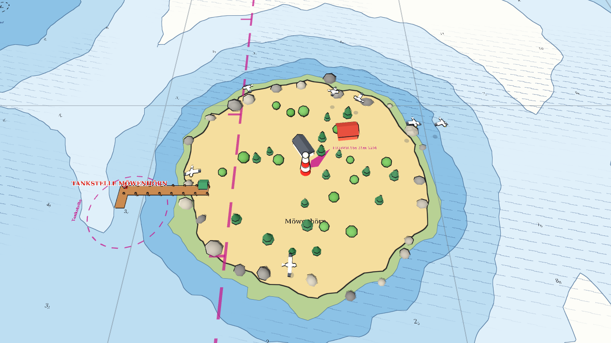

# Gefahren, Tiere, Effekte

Dieses Kapitel beschreibt die **jüngsten Bausteine**: Minenfelder, Polizeikontrollen,
Sirenen-Insel, Tiere und Wracks, dazu die Hilfsklassen für Effekte und Modellstil. Sie zeigen
gut, wie man **neue Spielmechaniken ohne Änderung von `main.gd`** ergänzt.

## Das Prinzip: eine Methode, `update_boat`

Alle Gefahrengebiete implementieren dieselbe Methode:

```gdscript
func update_boat(b: Boat, delta: float) -> void
```

`main.gd` sammelt beim Start alle Level-Kinder mit dieser Methode (`level.hazards()`) und ruft sie
in jedem Physikschritt für **jedes Boot** auf:

```gdscript
if state == "racing" or state == "finished":
    for h in _hazards:
        for b in boats:
            h.update_boat(b, delta)
```

Das Gebiet entscheidet selbst, ob das Boot betroffen ist, und löst eine **Boot-Funktion** aus:

| Auslöser | Boot-Funktion | Wirkung |
|---|---|---|
| Mine berührt | `explode()` | `out = true`, Explosion, ausgeschieden |
| Polizeigebiet | `start_hold(1)` | 8 s festgehalten |
| Sirenen-Insel | `start_hold(2, focus)` | 7 s festgehalten, Boot dreht zur Insel |

Dazu kommt `danger_circle()` (für die KI) und `danger_zones()` des Levels (für Karten).
Die Gebiete laufen nur **beim Host bzw. lokal**: Clients bekommen das Ergebnis über den
Schnappschuss (`out`, `hold_kind`, `hold_time`).

## `restricted_area.gd` { #restricted-area-gd }

`class_name RestrictedArea`, `@tool`, 230 Zeilen. `enum Kind { MINEN, POLIZEI }`,
Exporte: `kind`, `area_name`, `radius` (20 bis 250 m), `mine_count` (3 bis 60).

**Optik** (`_rebuild`):

* magenta gestrichelter Kreis mit kurzen Zähnen nach innen (wie die Gebietsgrenze), Name und
  Untertitel („Einfahrt verboten – Minengefahr“),
* **Sperrtonnen** (gelb mit Kreuz) alle ca. 24 m rund um den Kreis, wippend,
* bei Minen: `_place_mines()` verteilt `mine_count` Minen im Kreis mit **mindestens 12 m
  Abstand** und festem `seed`:

```gdscript
rng.seed = int(global_position.x * 7.0 + global_position.z * 13.0) + int(radius) * 31 + mine_count
while _mine_pos.size() < mine_count and tries < mine_count * 40:
    var a := rng.randf() * TAU
    var r := sqrt(rng.randf()) * (radius - 8.0)      # sqrt: gleichmäßig über die Fläche verteilt
    var p := Vector2(cos(a), sin(a)) * r
    ...                                              # nur annehmen, wenn 12 m von allen anderen entfernt
```

**Warum `sqrt(randf())`?** Würde man den Radius gleichverteilt würfeln, lägen die Punkte in der
Mitte viel dichter (die Ringe nahe der Mitte sind kleiner). Die Wurzel gleicht das aus.
Der **feste Seed** sorgt dafür, dass in Mehrspieler-Rennen alle Rechner dieselben Minen sehen.

**Spiellogik** (`update_boat`):

```gdscript
if kind == Kind.MINEN:
    # Vorwarnung 30 m vor der Grenze
    if d < radius + MINE_HIT:
        for m in _mine_pos:
            if p.distance_to(pos2d() + m) < MINE_HIT:     # 4,8 m
                b.explode(); return
else:                                                     # Polizei
    inside = d < radius
    if inside and b.hold_kind == 0 and b.immune_time <= 0:
        st["dwell"] += delta
        if st["dwell"] >= GRACE:                          # 1,6 s im Gebiet
            b.start_hold(1)
            Sfx.play("police_siren", -2.0)
    if not inside: st["dwell"] = maxf(0.0, st["dwell"] - 2.0 * delta)   # Verlassen baut ab
```

Je Boot merkt sich das Gebiet in `_state` (ein `Dictionary`, Schlüssel = das `Boat`-Objekt),
ob es schon **gewarnt** wurde, damit die Meldung nur einmal pro Einfahrt kommt.

## `siren_island.gd` { #siren-island-gd }

`class_name SirenIsland`, **`extends ShoalArea`**, 150 Zeilen. Eine Sirenen-Insel **ist** eine
Insel: Sie erbt Tiefenprofil, Küstenlinie, Bäume und Beschriftung und fügt hinzu:

```gdscript
func _init() -> void:
    kind = Kind.INSEL                           # immer eine Insel

func capture_radius() -> float:                 # Fangradius = Inselradius × Skalierung + song_range
    return radius * maxf(global_basis.x.length(), global_basis.z.length()) + song_range

func _rebuild() -> void:
    if not is_inside_tree(): return
    super._rebuild()                            # erst die normale Insel zeichnen ...
    ...                                         # ... dann Sirenen, Noten, Ringe draufsetzen
```

* **Sirenen:** drei Figuren (Schwanz aus Kegel, Rumpf aus Kapsel, Kopf, Haare) auf Felsen am Ufer,
  die sich wiegen (`rotation.z = sin(...)`).
* **Noten:** `HazardVisuals.siren_notes()`; in `_process` steigen sie in Spiralen auf und blenden
  über `scale = sin(phase·π)` ein und aus.
* **Wellenringe:** drei dünne Ringe (`add_ring` mit Radius 1,0), deren `scale` von Ufer
  bis Fangradius wächst, mit verblassender Farbe: ein sichtbarer Hinweis auf die Reichweite.
* Auf der Karte: gestrichelte magenta Linie am Fangradius und „Sirenengesang“.

`update_boat`: Kommt ein Boot unter `capture_radius()`, ist es nicht festgehalten und nicht
geschützt (`immune_time`), geht `b.start_hold(2, pos2d())`, plus Ton `siren_song`. 40 m vor der
Linie gibt es eine Warnmeldung.

## `hazard_visuals.gd` { #hazard-visuals-gd }

`class_name HazardVisuals`, nur `static`-Funktionen, die **Bauteile** der Gefahren liefern:

| Funktion | Ergebnis |
|---|---|
| `police_boat()` | weißes Boot mit blauem Streifen, Steuerhaus, Blaulicht (zwei Lampen), Schriftzug „POLIZEI“ |
| `flash_lamps(police, t)` | lässt die Lampen abwechselnd blinken (`sin(t·11 + i·π) > 0`) |
| `mine()` | schwarze Kugel, zehn Stacheln, rot blinkende Lampe; Meta-Einträge `body`, `lamp` |
| `siren_notes()` | vier Noten (Kopf, Hals, Fähnchen) in bunten, leuchtenden Farben |
| `orbit_notes(notes, t)` | Noten kreisen um das Boot (`cos/sin` mit Zeitoffset) |
| `mat(color, emissive)` | einfaches Material, optional leuchtend |

Bei den Stacheln der Mine sieht man ein typisches Geometrie-Problem: Ein `CylinderMesh` zeigt
mit seiner Achse nach **+Y**. Um ihn in Richtung `d` zu drehen, nimmt man
`Basis(Quaternion(Vector3.UP, d))`: die kürzeste Drehung von „oben“ nach `d`.

Das **Polizeiboot** und die **Noten** hängt das Boot selbst an sich (`_update_hold_visual` in
`boat.gd`), abhängig von `hold_kind`. Weil dieser Zustand im Schnappschuss steht, sehen auch
Clients Polizeiboot und Noten, ohne dass sie extra übertragen werden müssten.

## `sea_life.gd` { #sea-life-gd }

`class_name SeaLife`, `@tool`, 400 Zeilen. Fünf Arten in **einem** Skript (`enum Kind`),
umgeschaltet über `match kind`:

| Art | Aufbau | Bewegung (`_process`) |
|---|---|---|
| `TUEMMLER` | Körper aus 2 gestreckten Kugeln (Rücken, Bauch), Schnauze, Rückenflosse, Fluke, Brustflossen | kreisen mit `5,5 m/s`; Zyklus `4,6 s`: erst 30 % Sprung (`y = 2,5·sin(s·π) − 0,7`), dann unter Wasser; Nase folgt der Steigung (`atan2(dy, speed)`) |
| `WAL` | große Kugeln (Rumpf, Kopf, Bauch), Schwanzstiel, Fluke, Rückenflosse, **Blas** (`CPUParticles3D`) | Zyklus 24 s: auftauchen, an der Oberfläche (4 Bläser), abtauchen mit Fluke, unter Wasser |
| `MOEWEN` | Körper, Kopf, Schnabel, zwei **Flügel-Pivots** | Kreisflug (Radius, Höhe, Tempo je Möwe), Flügelschlag `sin(t·9)`, Schatten als dunkle Scheibe auf dem Wasser |
| `SEEHUNDE` | Körper, Kopf (Pivot), Flossen; Felsen darunter | Kopf hebt/dreht sich, Atmen (`scale.y`) |
| `WRACK` | Rumpf aus Box + Bug (Prisma), Deck, **Spanten**, Achterhaus, gebrochener Mast, Tang | keine; **fest** (`collision_points`) |



Zwei Tricks:

1. **Untertauchen ist „kostenlos“:** Die Karte ist eine undurchsichtige Fläche bei `y = 0`.
   Ein Tier mit `y < 0` verschwindet einfach dahinter. Deshalb genügt `position.y = Sinus`,
   um Springen und Abtauchen darzustellen.
2. **Schwanz sichtbar beim Abtauchen:** Beim Wal wird `rotation.x` (Nase nach unten) von 0 auf
   1,1 rad gedreht, während `y` sinkt: Die Fluke (Schwanz) ragt kurz **hoch aus dem Wasser**,
   bevor auch sie untergeht.

Die Wrack-Kollision liefert fünf Kreise entlang der Rumpfachse:

```gdscript
func collision_points() -> Array:
    for z in [-8.0, -3.5, 1.0, 5.5, 9.0]:
        var g := global_transform * Vector3(0, 0, z)       # mit Drehung des Bausteins
        out.append([Vector2(g.x, g.z), 3.4])
```

`Level.collision_points()` sammelt sie; `main.gd` prallt Boote daran ab, und die KI behandelt sie
wie Tonnen.

!!! tip "Eigene Tiere"
    Neue Art = ein Eintrag im `enum Kind`, eine Bau-Funktion (`_pinguin()`) und ein Block in
    `_rebuild`/`_process`. In `plugin.gd` nur die Namen-/Anzahl-Listen im Menü erweitern.

## `fx.gd` { #fx-gd }

`class_name Fx`, `@tool`, nur `static`. Kurze Effekte **aus Code**, ohne Szenen:

* `ripple(parent, pos, max_scale, time, color)`: ein flacher Torus, der per `Tween` wächst
  und verblasst, danach `queue_free`. Für Spritzer und Druckwelle.
* `explosion(parent, pos)`: Feuerball (Kugel, wächst von 1,5 auf 8, wird transparent),
  6 Rauchkugeln (steigen und wachsen), **Trümmer** (`CPUParticles3D` mit `one_shot`,
  Explosivität 1, Schwerkraft −22), zwei Druckwellen. Der Wurzelknoten ist `top_level` (bleibt
  an Ort und Stelle) und wird nach 3,4 s per Timer freigegeben.

**Beispiel:** `Tween` in drei Zeilen.

```gdscript
var tw := mi.create_tween()
tw.set_parallel(true)                                # mehrere Eigenschaften gleichzeitig
tw.tween_property(mi, "scale", Vector3(8, 0.04, 8), 1.2)
tw.tween_property(mat, "albedo_color:a", 0.0, 1.2)   # nur der Alpha-Kanal
tw.chain().tween_callback(mi.queue_free)             # danach aufräumen
```

## `model_style.gd` { #model-style-gd }

`class_name ModelStyle`, `@tool`, `static`. Der gemeinsame **Grafikstil**:

* **Tusche-Kontur** (`outline(root)`): Ein Shader (`OUTLINE_SHADER`) zeichnet jedes Mesh ein
  zweites Mal, **aufgeblasen** entlang der Normalen um eine feste **Pixelbreite**
  (`width_px = 1,4`) und mit `cull_front` (nur Rückseiten). Das ergibt eine dünne dunkle Linie
  rund um jedes Objekt, die bei jedem Zoom gleich breit bleibt. Gesetzt wird sie als
  `material_overlay`.

```glsl
void vertex() {
    vec4 clip = PROJECTION_MATRIX * MODELVIEW_MATRIX * vec4(VERTEX, 1.0);
    vec3 n = normalize((MODELVIEW_MATRIX * vec4(NORMAL, 0.0)).xyz);
    vec2 dir = (PROJECTION_MATRIX * vec4(n, 0.0)).xy;
    if (length(dir) > 0.0001) clip.xy += normalize(dir) * width_px * 2.0 / VIEWPORT_SIZE * clip.w;
    POSITION = clip;
}
```

* `tint(root, material_name, color)`: färbt alle Flächen mit einem bestimmten Materialnamen um
  (der Rumpf in der Spielerfarbe: `Rumpf_Gelcoat`).
* `no_shadows(root)`: schaltet den Schattenwurf aller Meshes ab (Performance für viele kleine
  Teile).
* `meshes_of(root)`: alle `MeshInstance3D` unterhalb eines Knotens.

!!! note "Warum ein eigener Kontur-Shader?"
    Godot hat keine eingebaute Konturlinie. Das Vergrößern der Rückseiten im Vertex-Shader ist
    die klassische Lösung und passt zum Zeichenstil der Seekarte.

## Beispiel: Ein neues Gefahrengebiet „Strudel“

Ein Strudel, der Boote verlangsamt, in 25 Zeilen und **ohne** eine andere Datei anzufassen:

```gdscript
@tool
class_name Whirlpool
extends Node3D

@export var radius := 30.0

func pos2d() -> Vector2:
    return Vector2(global_position.x, global_position.z)

func danger_circle() -> Array:                    # die KI umfährt ihn
    return [pos2d(), radius]

func update_boat(b: Boat, delta: float) -> void:  # main.gd ruft das jeden Schritt
    if b.out or b.towed:
        return
    var d := b.pos2d().distance_to(pos2d())
    if d < radius:
        b.vel *= 1.0 - 0.8 * delta                # Bremswirkung
        if b.message_time <= 0.0:                 # nicht jeden Schritt neu melden
            b.show_message("Strudel!", 1.0)
```

In den Level-Szenenbaum setzen, fertig: `Level.hazards()` und `Level.danger_circles()`
finden ihn über `has_method`.

## `shipping_lane.gd` { #shipping-lane-gd }

`class_name ShippingLane`, `@tool`, rund 300 Zeilen. Ein **Schifffahrtsweg** mit Berufsschiffen,
die man als Segler meiden muss. Ein einzelner Baustein genügt für ein ganzes Fahrwasser: Man
setzt ihn an den Anfang der Strecke, der Pfeil (lokal −Z) zeigt in Fahrtrichtung, `length` ist die
Länge. In `levels/05_lotsenrinne.tscn` steht er bei `(0, 190)` mit `length = 930`: Er läuft vom
Start durch die ganze Rinne nach Norden.

### Der Kerngedanke: Schiffe sind eine Funktion der Zeit

Die Schiffe haben **keinen Zustand**, den man speichern oder übertragen müsste. Ihre Position folgt
allein aus der Rennzeit `t`:

```gdscript
func ships_at(t: float) -> Array:
    var speed := speed_kn / 1.944                         # m/s
    var dur := (length + ship_length) / speed             # so lange braucht ein Schiff für die Strecke
    for dir_i in 2:                                       # 0 = in Pfeilrichtung, 1 = zurück
        var phase := phase_out if dir_i == 0 else phase_back
        var k_min := ceili((t - dur - phase) / interval)  # welche Schiffe sind gerade unterwegs?
        var k_max := floori((t - phase) / interval)
        for k in range(k_min, k_max + 1):
            var c := speed * (t - (phase + k * interval)) - ship_length * 0.5   # Mitte entlang der Bahn
            var along := c if dir_i == 0 else length - c                         # "zurück" läuft rückwärts
            var side := lane_offset if dir_i == 0 else -lane_offset              # rechts fahren
            var g := global_transform * Vector3(side, 0, -along)
            ...
```

Schiff Nummer `k` (auch negativ, damit zu Rennbeginn schon welche unterwegs sind) legt zur Zeit
`phase + k·interval` ab und fährt mit konstanter Geschwindigkeit. Die **Id** `k·2 + Richtung` legt
Name (`NAMES`) und Typ (Container, Tanker, Massengut) fest. Für jedes Schiff liefert die Funktion
`{id, pos, dir, vel, half, radius, name, type}`.

**Warum so?**

* **Netzwerk:** Jeder Rechner rechnet dasselbe aus. Es müssen keine Schiffe übertragen werden
  ([Netzwerk](netzwerk.md)).
* **Computergegner:** Die KI kann die Positionen in 4, 8, 12 Sekunden **vorausberechnen**
  ([Computergegner](ki.md)).
* **Tests:** Man setzt die Zeit auf einen Wert und weiß, wo die Schiffe sind (`tests/hazard_test.gd
  schiff`).
* **Keine Fehlerquellen:** Es gibt kein „Schiff ist hängen geblieben“.

!!! note "Wo die Zeit herkommt"
    `main.gd` schreibt in jedem Physikschritt `ShippingLane.clock = race_time`
    (`static var`, von allen Lane-Instanzen gelesen) und `running` (nur im Rennen). Die Optik
    läuft in `_process` mit einer eigenen Uhr `_t`, die zwischen den Takten weiterläuft und bei
    mehr als 0,25 s Abweichung wieder auf `clock` springt. Im Editor läuft sie von selbst, damit man
    die Schiffe sieht.

### Kollision und Warnung (`update_boat`)

Wie alle Gefahrengebiete hat die Schifffahrt `update_boat(boat, delta)`, das `main.gd` für jedes
Boot aufruft. Der Rumpf ist eine **Kapsel**: die Strecke Bug–Heck, aufgeblasen um `beam/2 + 1,5`.

```gdscript
var cp := Geometry2D.get_closest_point_to_segment(p, heck, bug)   # nächster Punkt der Rumpflinie
var d := p.distance_to(cp)
var reach := sh["radius"] + Boat.BOAT_RADIUS
if d < reach:
    var n := (p - cp) / d                              # Richtung vom Rumpf weg
    b.position += Vector3(n.x, 0, n.y) * (reach - d)   # aus dem Rumpf schieben
    b.ship_hit(n, sh["vel"])                           # zurückwerfen und bestrafen
```

`Boat.ship_hit` ([Das Boot](boot.md)) zieht von der Relativgeschwindigkeit den Anteil entlang der
Normalen ab (Abprallen, Faktor 1,6), halbiert fast die Fahrt (`× 0,7`), setzt `penalty = 5 s`
und lässt das Boot krängen. Die Warnung (Meldung mit Schiffsname, Signalhorn `ship_horn`) kommt
einmal je Boot und Schiff alle 25 s, sobald der Abstand zum Rumpf unter 95 m liegt.

### Optik

`_process` hält einen **Pool** von Schiffsknoten (`_nodes`, Schlüssel = Id): Neue Schiffe
bekommen einen Knoten (`_build_ship`), Knoten ohne Schiff werden freigegeben. `top_level = true`
lässt die Schiffe unabhängig vom Level-Knoten bewegen. Ausrichtung: `rotation.y = atan2(dir.x,
dir.y)`, dazu leichtes Schaukeln.

`_build_ship(type, name)` baut aus Boxen:

* Rumpf (Box) mit **Bug** (`PrismMesh`) und rotem Unterwasseranstrich,
* **Brücke** und Schornstein am Heck,
* je nach Typ: Container in bunten Stapeln, Tanks mit Rohrleitung oder Lukendeckel mit Kränen,
* **Kielwasser**: weiße, halbtransparente Dreiecke hinter dem Schiff, dazu ein Ring an der Bugspitze,
* ein schwebendes Namensschild.

Auf der Karte stehen zwei Reihen **Richtungspfeile** (magenta) und die Beschriftung, die
`Level.lane_lines()` für Vorschau und Minikarte liefert.

### Eigene Schifffahrt einbauen

1. Im Editor „+ Baustein → Schifffahrtsweg (Berufsschiffe)“, an den Anfang der Strecke setzen,
   so drehen, dass der Pfeil in Fahrtrichtung zeigt.
2. `length` auf die Länge des Fahrwassers, `lane_offset` etwa ein Viertel der Fahrwasserbreite.
3. `phase_out`/`phase_back` so wählen, dass **beim Start keine Schiffe in den Startplätzen
   stehen**. Die Positionen zur Zeit 0 kann man mit `lane.ships_at(0.0)` ausgeben.
4. `tests/hazard_test.gd` kopieren und prüfen, dass ein Boot im Weg getroffen wird.
