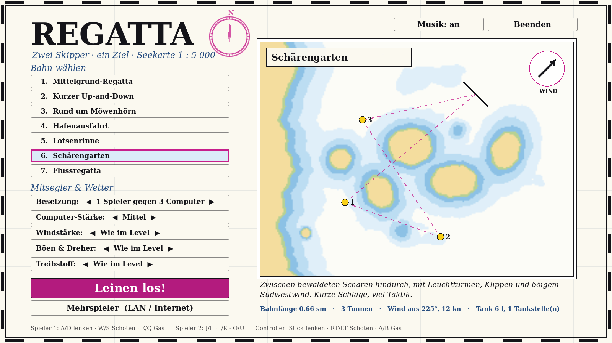
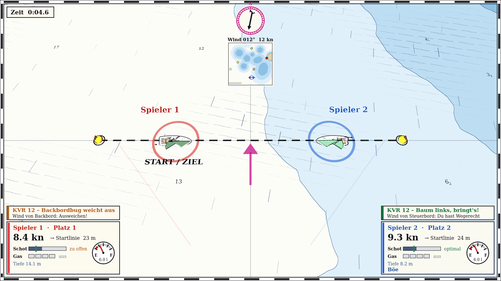

# Spielanleitung

## Schnellstart

1. Im Menü eine **Bahn** wählen.
2. **Besetzung** einstellen: 2 Spieler, 1 Spieler gegen 1 oder 3 Computer, 2 gegen 2 oder
   Zuschauen mit vier Computern.
3. Optional Computer-Stärke, Windstärke, Böen und Treibstoff anpassen.
4. **Leinen los!** Nach dem Countdown geht es über die Startlinie.

Im Menü zeigt die Karte rechts die gewählte Bahn mit Tonnen, Startlinie, Windpfeil,
**Tankstellen** (rote Punkte mit „F“) und **Warngebieten** (magenta Kreise).

## Steuerung

| | Controller | Tastatur Spieler 1 | Tastatur Spieler 2 |
|---|---|---|---|
| Lenken (Pinne) | linker Stick | A / D | J / L |
| Schot dicht / fieren | RT / LT oder R / L (oder rechter Stick) | W / S | I / K |
| Gas hoch (Motor springt an) | A / Steuerkreuz ↑ | E | O |
| Gas runter (auf 0 = Motor aus) | B / Steuerkreuz ↓ | Q | U |
| Nächstes Rennen (nach dem Ziel) | Start | Leertaste | Enter |

Weitere Tasten:

| Taste | Wirkung |
|---|---|
| `F5` | Rennen neu starten (nur Host bzw. lokal) |
| `Esc` | zurück ins Menü (bzw. in die Lobby) |
| `M` | Musik an/aus |
| `T` | Segel-Overlay an/aus |
| `F11` oder `Alt+Enter` | Vollbild umschalten |
| `F9` | **Debug-Modus**: Tank bleibt voll, Motor 20-fach stark (ca. 27 kn), damit man schnell jeden Punkt der Karte erreicht. Auch per Startargument `--debug`; im HUD steht „DEBUG“ |

!!! note "Controller"
    Ein Controller kann auch ein Switch-Pro-Controller oder Joy-Con sein, der per Bluetooth
    verbunden ist. **Ein einzelner Joy-Con genügt:** Stick lenkt, die Schultertasten (L/R
    bzw. ZL/ZR) holen und fieren die Schot, die Frontknöpfe geben Gas.
    Technik: [Eingabe](../skripte/eingabe.md).

## Die Bahn

* Die **Startlinie** liegt zwischen zwei Tonnen. Über die Linie in Pfeilrichtung startet das
  Rennen.
* Die **gelben Bahnmarken** werden in der angezeigten Reihenfolge gerundet. Es genügt, in den
  gestrichelten Kreis (20 m) um die Marke zu fahren. Die nächste Marke und ihre Entfernung
  stehen in deinem Spielerfeld.
* Am Schluss geht es zurück durch dieselbe Linie, jetzt in Gegenrichtung. Das ist das Ziel.
* Die **magenta Linie mit „T“-Zeichen** begrenzt das Regattagebiet. Wer hinausfährt, wird
  abgebremst und gestoppt.

## Segeln in einer Minute

* **Wind:** Die Windrose oben zeigt, woher der Wind kommt. Graue Striche auf dem Wasser
  zeigen seine Richtung, Riffel-Schraffur zeigt eine **Böe**.
* **Gegen den Wind** (etwa 40° links und rechts davon) kommt man nicht voran. Dort hilft nur
  **kreuzen**: im Zickzack hoch und durch Lenken **wenden**. Dreh zügig durch den Wind, sonst
  bleibst du stehen („Im Wind – abfallen!“).
* **Schot:** Der grüne Strich im Schot-Balken zeigt die beste Stellung. Ist die Schot zu
  offen, killt das Segel. Ist sie zu dicht, krängt das Boot und wird langsam. Am Wind dicht
  holen, vor dem Wind weit fieren.
* **Segel-Overlay:** Die Segel selbst zeigen die Qualität der Trimmung. Grün heißt optimal,
  über Gelb und Orange wird es schlechter, rot blinkend heißt: das Segel killt (flattert).
  Die **grüne Linie auf dem Wasser** zeigt, wo der Baum idealerweise stehen sollte. Wenn
  Segel und Linie übereinander liegen, passt es. Mit `T` abschaltbar.
* **Wende mit Schub:** Wer mit Fahrt (über 1,3 m/s) durch den Wind dreht, bekommt einen
  kurzen Beschleunigungsschub („Wende – Schub!“). Zwischen zwei Schüben liegen mindestens
  5 Sekunden. Wer zu langsam wendet, bleibt im Wind hängen.
* **Windschatten:** Hinter einem anderen Boot bekommst du weniger Wind. Das kann man nutzen
  und sollte es selbst vermeiden. Noch viel stärker bremst das **Lee von Land**: hinter
  Inseln, Molen und Ufern bis etwa 170 m fast Flaute. Auf der Karte erkennst du es an den
  fehlenden Windstrichen.
* **Am schnellsten** ist das Boot mit halbem Wind (seitlich).

!!! tip "Die einfache Faustregel"
    Zieh die Schot, bis das Segel **gerade nicht mehr flattert**, und lass sie dann einen
    Hauch locker. Das Overlay zeigt genau diesen Punkt: Wenn die Segel grün sind, passt es.

## Vorfahrtsregeln (KVR)

Nähern sich zwei Boote auf Kollisionskurs, blendet das Spiel über dem Spielerfeld **die passende
Regel der Kollisionsverhütungsregeln (KVR)** ein. Das hat **keine Folgen** für das Rennen, es
soll nur unterhalten und etwas beibringen. Grün heißt: Du hast **Wegerecht**, orange: Du musst
**ausweichen**.

| Situation | Wer weicht aus? | Meldung |
|---|---|---|
| Beide unter Segel, Wind auf **verschiedenen Seiten** (Regel 12) | Wind von **Backbord** (links) weicht aus. Wer den **Baum links** hat (Wind von Steuerbord), hat Wegerecht. | „Baum links, bringt's!“ |
| Beide unter Segel, Wind von **derselben Seite** (Regel 12) | das **Luvboot** (dem Wind näher) weicht dem Leeboot aus | „Luv gibt Lee Raum“ |
| Eines **überholt** (Regel 13, aus dem Sektor hinter dem anderen, schneller) | der **Überholer** | „Überholer hält Abstand“ |
| Eines läuft mit **Motor**, das andere segelt (Regel 18) | das **Maschinenfahrzeug** | „Maschine weicht Segler aus“ |
| Beide mit Motor, **Gegenkurs** (Regel 14) | beide nach Steuerbord | „Gegenkurs“ |
| Beide mit Motor, **kreuzend** (Regel 15) | wer den anderen an **Steuerbord** hat | „Kurs kreuzt“ |
| Berufsschiff im Fahrwasser (Regel 9) | du | „Enges Fahrwasser“ |

!!! tip "Merkspruch"
    **„Baum links, bringt's!“** Liegt dein Großbaum an der linken Seite, weht der Wind von
    rechts (Steuerbord). Dann hast du Wegerecht. Wer den Baum rechts hat, muss ausweichen.

## Kollisionen

Wer mit einem anderen Boot zusammenstößt, **verliert Fahrt** und hat eine Weile
**verhedderte Segel** (bis etwa 4 Sekunden weniger Vortrieb). Es trifft beide, aber stärker
den, der mit mehr Fahrt aufgefahren ist. Dauerhaftes Aneinanderliegen bremst ebenfalls.
Niemand wird dadurch aus dem Rennen geworfen.

## Seekarte lesen

* **Tiefen:** Je dunkler das Blau, desto flacher. Die kleinen Zahlen sind Wassertiefen in
  Metern. Die Dehler hat 1 m Tiefgang.
* **Grundberührung** bremst stark. Wer richtig festsitzt, bekommt nach ein paar Sekunden den
  **Schlepper** geschickt. Der kommt gemächlich und zieht dich ins Tiefe.
* **Kardinaltonnen** (gelb-schwarz) zeigen, auf welcher Seite das tiefe Wasser liegt. An der
  Nordtonne fährt man nördlich vorbei, an der Südtonne südlich und so weiter.
  Schwarz-rot-schwarz markiert eine **Einzelgefahr**, rote und grüne Tonnen begrenzen ein
  **Fahrwasser**. An allen Tonnen prallt man ab.
* **Strömungen:** Pfeile mit „x kn“ und wandernde Schlieren auf dem Wasser. Sie versetzen
  das Boot. Mit dem Strom ist man schneller, dagegen langsamer. Manche Gezeitenströme
  kentern während des Rennens.

## Motor und Tanken

* **Gas hoch** wirft den Außenborder an (kurz der Anlasser). **Gas ganz runter** stellt ihn
  ab. Es gibt 4 Stufen, Vollgas sind etwa 6 kn.
* Die **Tankuhr** in deinem Spielerfeld zeigt den Sprit, rot heißt Reserve. Vollgas
  verbraucht viel, Halbgas nur gut ein Drittel davon.
* Wie viel im Tank ist, stellst du im Menü unter **Treibstoff** ein. Normalerweise reicht
  es **nicht** für die ganze Bahn.
* **Tankstellen** erkennst du am Steg mit roter Zapfsäule und dem magenta gestrichelten
  Liegeplatz. Dort anhalten und den Motor aus (Gas auf 0), dann wird getankt. Das dauert ein
  paar Sekunden, in denen die Segler weiterfahren. Gut überlegen, ob es sich lohnt!

## Computergegner

| Stärke | Verhalten |
|---|---|
| Leicht | reagiert langsam, trimmt ungenau, Motor nur, wenn es im Wind hängen bleibt |
| Mittel | solider Segler mit kleinen Fehlern, Motor eher selten |
| Schwer | trimmt fast perfekt, nutzt Winddreher und Böen, setzt den Motor taktisch ein |

Die KI segelt mit denselben Eingaben wie ein Mensch und hat keine Physik-Vorteile. Sie
umfährt Untiefen, Tonnen, Wracks und alle Gefahrengebiete. Technik: [Computergegner](../skripte/ki.md).
