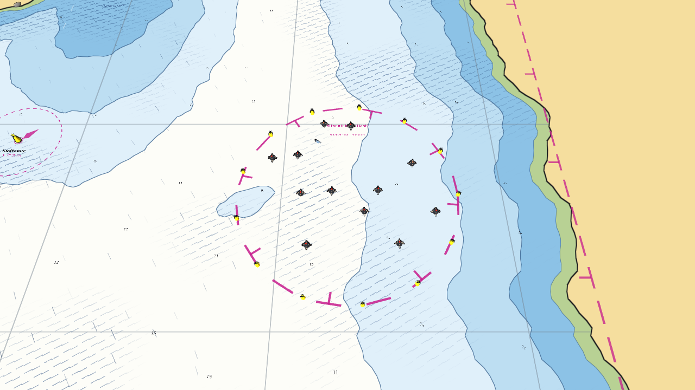
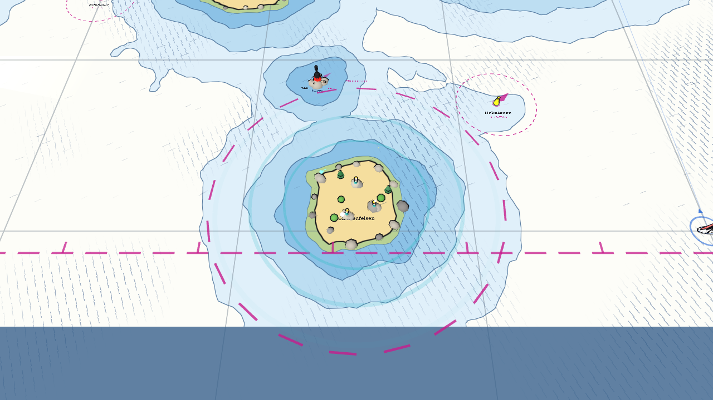
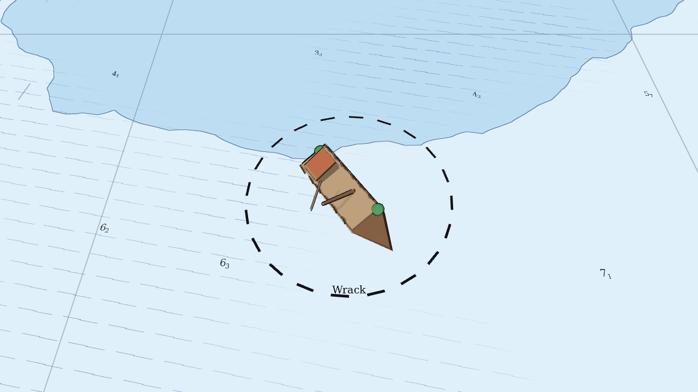

# Gefahren und Tiere

Gefahrengebiete sind in der Karte **magenta gestrichelt** umrandet. Sie sind absichtlich
sichtbar: Man darf sie jederzeit ansehen, nur nicht in sie hineinfahren. Die Technik dahinter
steht in [Gefahren, Tiere, Effekte](../skripte/gefahren.md).

## Minenfeld

* Schwarze Kugeln mit Stacheln und rot blinkendem Licht, umgeben von gelben Sperrtonnen.
* Wer eine Seemine **berührt** (Abstand unter 4,8 m), **explodiert**: Feuerball, Rauch,
  Trümmer, Druckwelle. Das Boot sinkt und ist **aus dem Rennen**.
* Die anderen segeln weiter. Sind alle Boote draußen, endet das Rennen mit „Alle Boote
  verloren!“.
* 30 m vor der Grenze erscheint die Meldung „Achtung: Minenfeld voraus!“.

## Polizei-Sperrgebiet

* Wer hineinfährt, bekommt „Sperrgebiet! Sofort umkehren!“. Bleibt das Boot **1,6 Sekunden**
  im Gebiet, nähert sich die **Wasserschutzpolizei** mit Blaulicht und Sirene.
* Das Boot wird **8 Sekunden** festgehalten und durchsucht (Motor aus, Fahrt läuft aus,
  Steuern und Schot gesperrt).
* Danach gibt es **25 Sekunden Schonfrist**, damit man das Gebiet verlassen kann.

## Sirenen-Insel

* Die Insel hat Sirenen auf den Felsen, wandernde Noten und türkise Wellenringe. Die
  gestrichelte magenta Linie zeigt, **wie nah man ihr kommen darf**.
* Wer die Linie überfährt, bleibt stehen, das Boot dreht sich langsam zur Insel, rund
  **7 Sekunden** lang. Dann 25 Sekunden Schonfrist.

## Tiere und Wracks

| Tier | Verhalten |
|---|---|
| Tümmler | Gruppe springt in Bögen im Kreis, Spritzer beim Ein- und Austauchen |
| Wal | zieht Kreise, taucht auf, bläst eine Fontäne, taucht mit hochgereckter Fluke ab |
| Möwen | kreisen mit Schlagflügeln, ihr Schatten läuft über das Wasser |
| Seehunde | liegen auf Fels oder Sandbank, heben den Kopf |
| Wrack | gestrandetes Schiff mit Spanten und Mast, **fest**: Boote prallen ab, die KI umfährt es |

Alle Tiere sind reine Dekoration und stören die Boote nicht.
