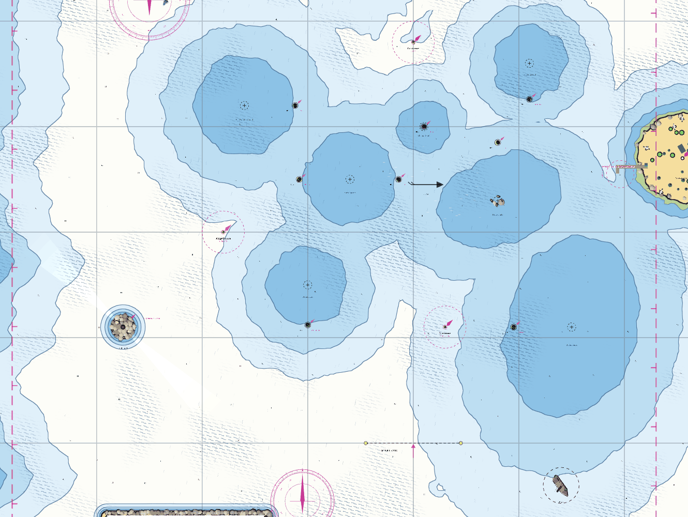
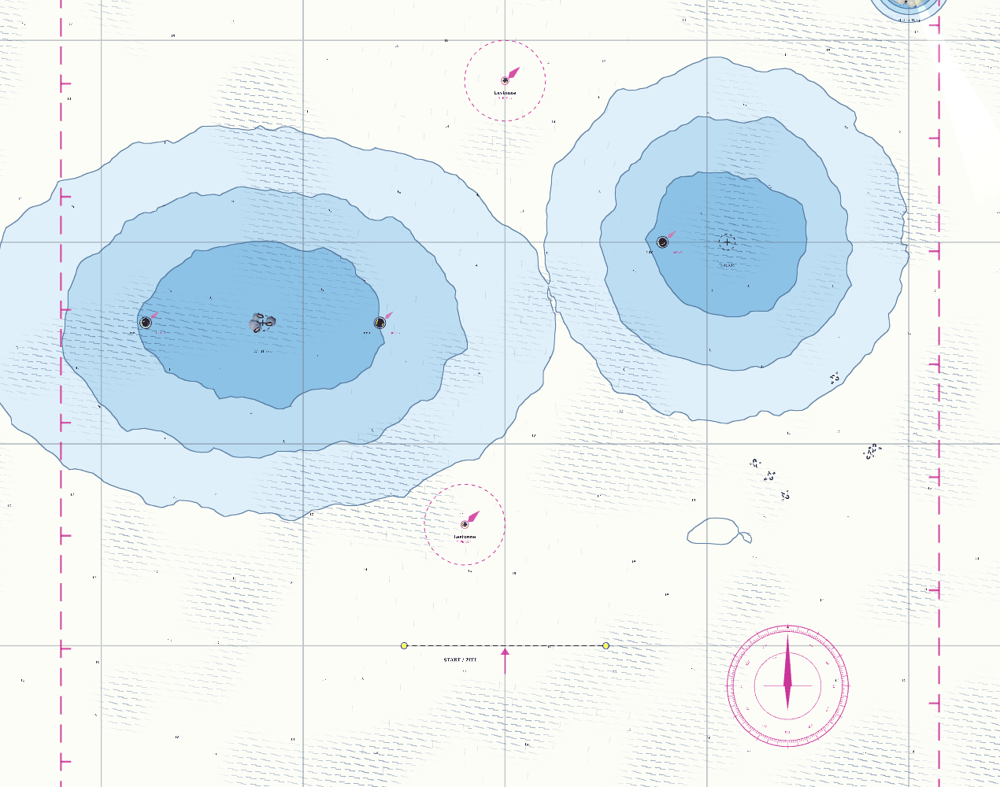
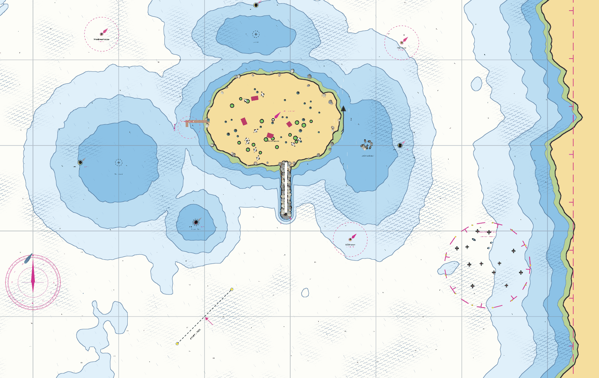
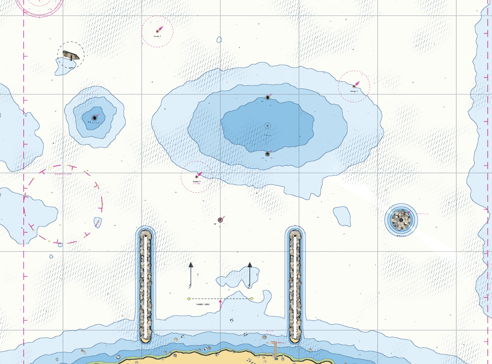
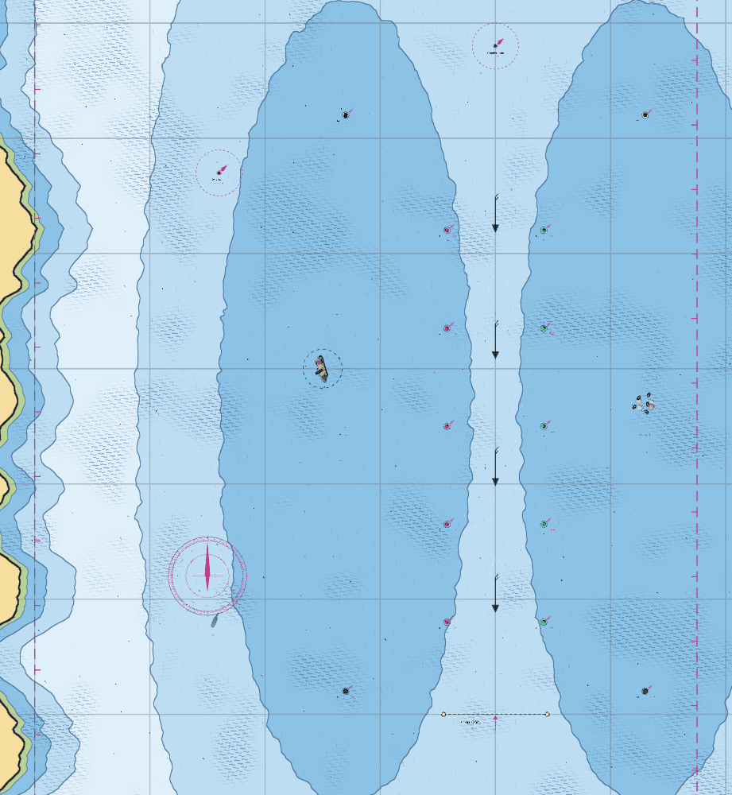
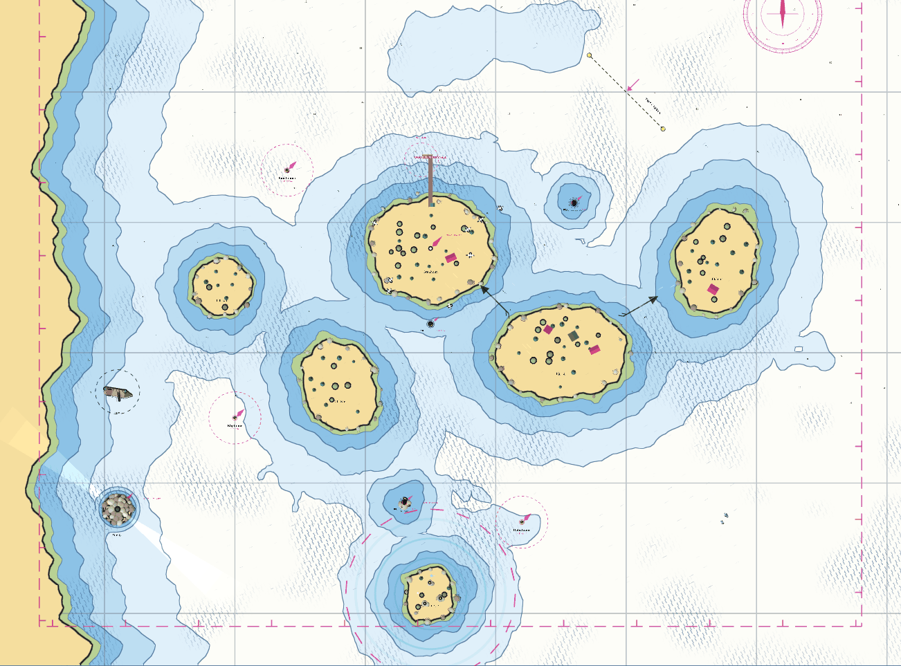
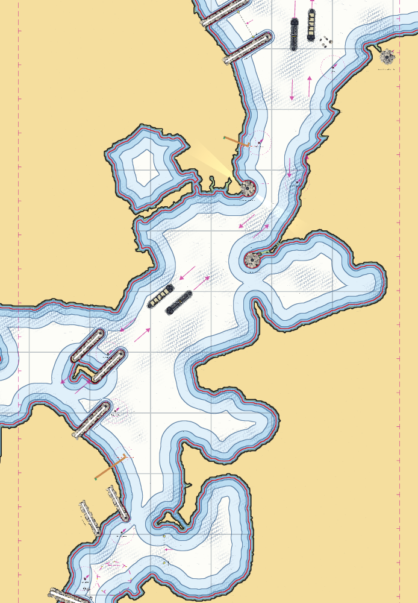
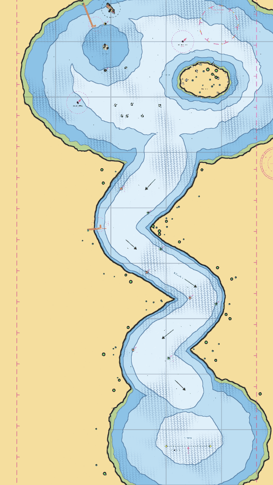

# Die Karten

Die vollständigen Karten aller Bahnen, senkrecht von oben gesehen, **Norden ist oben**. Sie
zeigen das Regattagebiet (die gestrichelte magenta Linie mit den kleinen „T“-Zeichen ist
seine Grenze). Sie entstehen automatisch mit `tests/map_shots.gd`
([Werkzeuge und Tests](../skripte/werkzeuge.md#screenshots)).

!!! tip "So liest man die Karte"
    * Je **dunkler das Blau**, desto flacher. Weiß ist tiefes Wasser, Gelb ist Land.
    * **Gelbe Punkte mit gestricheltem Kreis** sind die Bahnmarken, in diesen Kreis (20 m) muss man
      zum Runden fahren. Die gestrichelte schwarze Linie mit den beiden gelben Punkten ist die
      **Start- und Ziellinie**.
    * **Magenta gestrichelte Kreise mit Tonnen** sind Gefahrengebiete (Minen, Polizei,
      Sirenen). **Orange Stege** sind Tankstellen.
    * Die **rote Linie** ist die **1-m-Tiefenlinie**: Dahinter ist es flacher als der Tiefgang (1 m),
      das Boot läuft auf Grund.
    * **Pfeile** zeigen Strömungen, die **Schraffur** zeigt Böen.
    * Die **grauen Linien** sind ein Raster im Abstand von 100 m.

## Mittelgrund-Regatta

Dreieckskurs um die Untiefen. Gut zu sehen: die Kardinaltonnen an den Sandbänken, der Plattenstrom (Pfeil) in der Mitte, die Insel Möwenhörn mit Tankstelle rechts, das Wrack unten rechts.

## Kurzer Up-and-Down

Die kleinste Bahn: eine Luvtonne im Norden und eine Leetonne nahe dem Start, dazwischen zwei Sandbänke.

## Rund um Möwenhörn

Einmal um die große Insel mit der Mole nach Süden. **Rechts unten** liegt das Minenfeld mit den schwarzen Minen und gelben Sperrtonnen, rechts am Rand die Küste.

## Hafenausfahrt

Start zwischen den beiden Felsmolen am unteren Rand, die Hafenstadt ganz unten. Links das **Polizei-Sperrgebiet**, oben links ein Wrack auf einer Sandbank.

## Lotsenrinne

Die Rinne zwischen den beiden Sandbänken ist durch rote und grüne Tonnen markiert. Die **Tankstelle** liegt am Westufer (links), innerhalb des Regattagebiets. Auf der Westerbank liegt ein Wrack, die Seehunde sonnen sich auf der Osterbank.

## Schärengarten

Sechs bewaldete Inseln. Die **Tankstelle** steht auf der Nordseite von Granholm (Mitte oben), die **Sirenen-Insel** mit dem gestrichelten Fangkreis liegt unten in der Mitte. Am linken Rand ein Leuchtturm und ein Wrack.

## Kieler Förde

Küste und Wassertiefe stammen aus der echten Seekarte „Kieler Förde“ (Nautic Publications S2,
1 : 40 000), etwa 1 : 11 gestaucht. Die Küste der Karte bleibt erhalten, nur zu schmale Stellen (die
Enge, Kanäle, die Südspitze) sind um bis zu 26 m verbreitert, damit sie spielbar sind. Norden ist oben. **Unten links** liegt die Südspitze Hörn mit dem Kreuzfahrtterminal
Ostseekai, daneben im Osten die **Schwentinemündung** mit dem Marine-Arsenal (Start). Am Westufer
folgen von unten nach oben Düsternbrooker Hafen, Tirpitzmole und die **NOK-Schleuse Holtenau**
mit dem Kanal, der nach links aus der Karte läuft. Dann kommt die **Friedrichsorter Enge**: von
Westen ragt die Landzunge mit dem **Leuchtturm Friedrichsort** weit ins Wasser, von Osten die mit
dem **U-Boot-Ehrenmal Möltenort**. Weiter nördlich liegt am Ostufer das **Marine-Ehrenmal
Laboe**, oben links der Olympiahafen Schilksee mit der grünen **Ziellinie**. Die magenta Pfeile
zeigen den Schifffahrtsweg: Er beginnt an der NOK-Schleuse, quert die Förde zur Enge und läuft
dann nach Norden zur Ostsee.

## Flussregatta

Vom Kleinen See unten den Mühlenfluss hinauf in den Großen See oben. Die Pfeile zeigen die Strömung, oben rechts das Vogelschutzgebiet mit Polizeikontrolle.

Zu jeder Bahn die Hinweise und Besonderheiten: [Die Bahnen](bahnen.md). Eigene Bahnen:
[Eigene Bahnen bauen](../referenz/bahnen-bauen.md).
