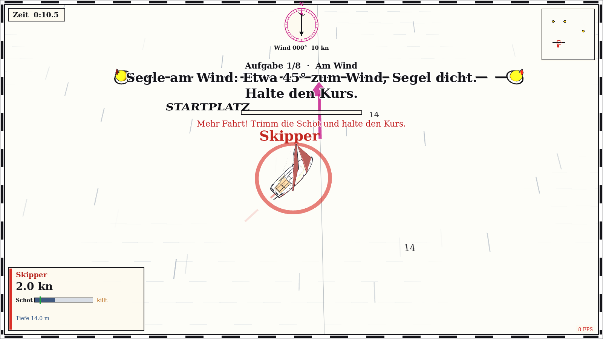
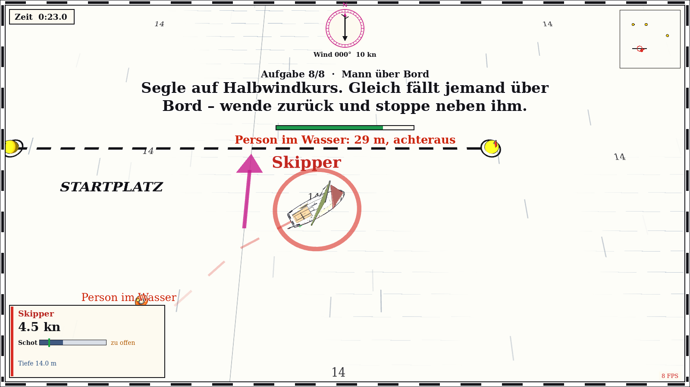

# Segelschule (Tutorial)

Die **Segelschule** ist ein Level, das nicht als Regatta, sondern als **Tutorial für einen Spieler**
abläuft: kein Countdown, keine Gegner, keine Rangliste, kein Ziel. Du löst nacheinander acht
Aufgaben; bei konstantem **Nordwind (10 kn), ohne Böen, ohne Motor**, damit jede Übung gleich
bleibt. Wähle im Menü die Bahn „Segelschule“ und starte mit Start/Enter (auch mit dem Controller).
Die Besetzung (2 Spieler, Computer …) und die Wind-Einstellungen aus dem Menü gelten hier nicht.

Die **Anleitung** der laufenden Aufgabe erscheint als große Schrift **mittig über deinem Boot**,
darüber „Aufgabe n/8“, darunter ein **Fortschrittsbalken** und – wenn etwas nicht stimmt – ein
kurzer roter **Hinweis** („Zu hoch am Wind (38°): etwas abfallen“). Ist eine Aufgabe gelöst, hörst du
ein Glöckchen und die nächste erscheint. Aufgaben lassen sich nicht überspringen.

## Die acht Aufgaben

| # | Aufgabe | Was verlangt wird |
|---|---|---|
| 1 | **Am Wind** | Segle **40°–55°** zum wahren Wind und halte den Kurs **6 Sekunden** (mindestens 1,2 m/s Fahrt) |
| 2 | **Halber Wind** | wie oben, aber **80°–100°** (Wind quer von der Seite) |
| 3 | **Raumschots** | **120°–145°** (Wind schräg von hinten) |
| 4 | **Vorwind** | **165°–180°** (Wind direkt von hinten) |
| 5 | **Vollkreis** | einmal ganz herumdrehen, **340°** in dieselbe Richtung, mit Fahrt |
| 6 | **Achten** | Umrunde die **linke Regattatonne nach links**, danach innerhalb von **120 s** die **rechte Tonne nach rechts**; die Drehung zählt nur im Umkreis von **45 m** um die Tonne |
| 7 | **Aufschießer** | Lauf die gelbe **Übungstonne** mit Fahrt an (aus mehr als 25 m, mindestens 1,5 m/s), schieße in den Wind auf und bleib **höchstens 8 m** daneben stehen (unter 0,5 m/s, Bug höchstens 45° neben dem Wind) |
| 8 | **Mann über Bord** | Segle mit Fahrt auf Halbwindkurs; kurz darauf fällt jemand über Bord (Rettungsring mit Licht, 15 m hinter dir). Wende zurück und stoppe **höchstens 6 m** neben ihm (unter 0,8 m/s) |

Der **wahre Windwinkel** ist der Winkel zwischen deinem Bug und der Richtung, aus der der Wind
kommt: 0° ist genau gegen den Wind, 90° Halber Wind, 180° Vorwind. Die Windrose oben zeigt, woher
der Wind weht (hier immer aus Norden).

## Tipps

* **Am Wind:** Schot dicht holen, Kurs etwa 45° zum Wind. Killen die Segel (flattern), bist du zu hoch:
  etwas abfallen. Das Segel-Overlay (`T`) zeigt, ob die Schot passt.
* **Raumschots/Vorwind:** Schot fieren, Vorwind notfalls ganz offen. Auf Vorwindkurs vermeidest du
  eine Patenthalse, indem du den Kurs nicht zu weit über 180° hinaus verlässt.
* **Vollkreis und Acht:** Mit Fahrt drehen (unter 0,8 m/s zählt nichts). Eine Acht besteht aus zwei
  gegenläufigen Kreisen, bei dem einen läuft die Tonne an Backbord, bei dem anderen an Steuerbord.
  Die Fortschrittsanzeige zeigt, wie weit der Kreis schon ist; wer zu weit von der Tonne wegkommt,
  fängt neu an.
* **Aufschießer:** Zum Anlauf auf Halbwindkurs auf die Tonne zufahren, Schot fieren und kurz vor der
  Tonne scharf in den Wind drehen. Das Boot läuft aus und bleibt stehen.
* **Mann über Bord:** Ruhig bleiben, nicht stoppen. Wende (oder Halse) und fahre die Person auf
  Halbwindkurs an, dann in den Wind schießen. Die Anzeige nennt Entfernung und Richtung zur Person.

## Abschluss

Nach der letzten Aufgabe erscheint **„Segelschule bestanden!“** mit deiner Zeit. Mit Start/Enter
(Controller: Start-Taste) beginnst du von vorn, mit `Esc` oder der **Zurück-Taste** (1 s halten)
gehst du zurück ins Menü.

Technik und Anpassung der Werte: [Tutorial-Skript](../skripte/tutorial.md).
